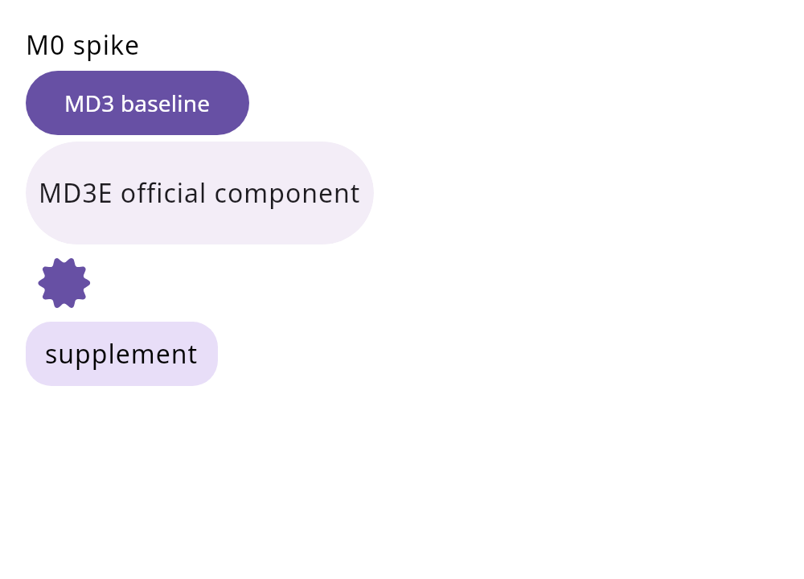

# M0 技术栈验证 · 实测报告

> 执行环境：Linux x86_64 容器（32 核 / 123 GB RAM），2026-11-10
> 执行对象：`m0-spike/`（单 `shared` 模块，四 target）
> 结论一句话：**Gate ③ 全绿并扩展到四 target；Gate ② 完成 JVM + Android 侧；Gate ①④⑤ 及 iOS 运行时验证仍需 macOS 或真实源站点。**
>
> 补遗（2026-11-11，MacBook Air M2 / macOS 26.6.2 / Corretto 21.0.12）：
> `runDesktopSpike` / `cookieSpike` / `screenshotSpike` / `sourceSpike(manga_dex)` 在 ARM64 上复现全绿；
> 新增 `commonTest`（6 套件 28 用例）+ `desktopTest`（9 套件 38 用例），
> `testAndroidHostTest` 与 `desktopTest` 全绿；`iosSimulatorArm64Test` 已具备用例，
> framework 链接验证进行中。详见第 3.8–3.9 节。

---

## 1. 环境

| 项 | 值 | 说明 |
|---|---|---|
| OS | Linux x86_64（容器，无 KVM） | 无法运行 Android 模拟器 |
| JDK | Amazon Corretto **21.0.13** | 原 `gradle.properties` 硬编码 macOS 路径，已改为 `JAVA_HOME` |
| Gradle | **9.4.1**（新增 wrapper） | 官方 distribution 在本机不可达，wrapper 指向腾讯镜像 |
| Android SDK | platform **android-37.0**、build-tools **36.0.0**、platform-tools 37.0.1 | 注意包名是 `android-37.0` 而非 `android-37`（与 `feasibility.md:81` 记录一致） |
| Kotlin | 2.4.21 | 未改动 |
| CMP | 1.12.2 + material3 1.12.0-alpha03 | 未改动 |

---

## 2. Gate 逐条判定

| # | Gate（`architecture.md:968`） | 状态 | 证据 |
|---|---|---|---|
| ① | 真实 Venera 源三端 JSON 一致 | **desktop 侧通过（Linux + Mac 双机复现）** | 真实 `manga_dex.js` 跑通 search + loadInfo，详见第 3.5 节与 3.8 节；commonTest 已锁 Ksoup/契约/存储三端一致，三端真机对比仍待补 |
| ②a | `memoryLimit = 32 MB` 生效 | **通过（+ desktopTest 回归）** | `MEMORY_LIMIT=33554432`；`QuickJsBehaviorTest` 在 Mac 复现 |
| ②b | `withTimeout` 中断 `while(true)` | **通过（+ desktopTest 回归）** | `INTERRUPT=OK QuickJsInterruptedException`；同上 |
| ②c | 16 KB page size 下 so 加载 | **Android 侧通过** | 四 ABI `p_align = 0x4000`（详见 3.3） |
| ②d | iOS 无 JIT entitlement 运行 | **部分：测试基建就绪，运行时仍待真机** | commonTest（纯逻辑 28 用例）已可在 `iosSimulatorArm64Test` 运行；QuickJs suspend 链在 iOS 侧仍需真机/模拟器执行，framework 链接验证进行中 |
| ③ | 全部依赖在 android / ios / jvm 可解析 | **通过（+ framework 链接）** | 四 target 均编译出产物（详见 3.1）；已补 `KotlinNativeTarget.framework{SharedSpike}`，`linkDebugFramework*` 可用；`android.withHostTest` 已启用 |
| ④ | 官方 Expressive 组件三端截图一致 | **部分通过（desktop 双机复现）** | desktop 已出真实渲染图（Linux + Mac `spike-desktop.png` 31KB）；iOS / Android 截图待真机；Navigation N1–N4 纯逻辑已在 commonTest 锁定 |
| ⑤a | ZoomImage 无 OOM | **最小前置通过，真机压测仍未执行** | `P0BehaviorTest.largeImageMetadataDoesNotOom` 锁 8000×20000 分块数学（640MB→≥3 tile）；真实子采样渲染仍需真机 |
| ⑤b | KCEF 可初始化 | **移出范围** | 桌面不内嵌浏览器，见 ADR-009 与 3.6；`offlineDesktopRuntime` 转正为正式配置 |
| ⑤c | PDF 平台矩阵确认 | **仅依赖层 + 符号冒烟** | 三端 variant 齐备（编译通过），渲染未验 |

---

## 3. 已完成的实测

### 3.1 四 target 编译（Gate ③）

```
$ ./gradlew :shared:compileKotlinDesktop \
             :shared:compileAndroidMain \
             :shared:compileKotlinIosArm64 \
             :shared:compileKotlinIosSimulatorArm64
BUILD SUCCESSFUL
```

| target | 产物 | 大小 |
|---|---|---|
| desktop | `build/classes/kotlin/desktop` | 132 K |
| android | `build/classes/kotlin/android` | 88 K |
| iosArm64 | `.../iosArm64/main/klib/shared/default` | 136 K |
| iosSimulatorArm64 | 同上 | 136 K |

**关键发现：iOS klib 交叉编译在 Linux 上可行。** Kotlin 2.4.21 允许在非 macOS 主机编译 Apple target 的 IR / klib，不需要 Xcode。这意味着四 target 的「源码可编译性」检查可以直接放进 Linux CI，不必占用 Mac 机器。只有 `linkDebugFramework*`（链接成 framework）与运行需要 macOS。

### 3.2 quickjs-kt 行为（Gate ②a / ②b）

```
FULL_CHAIN={"body":"<html><h1>fixture</h1></html>","hash":"stub-hash"}
MEMORY_LIMIT=33554432 TIMEOUT=10000 USED=67064
INTERRUPT=OK QuickJsInterruptedException
```

- Promise 链：`await Network.get()` → `Convert.md5()` → `JSON.stringify` 全链路正确，印证了 `feasibility.md:76` 的「必须用 top-level await」结论。
- 内存上限：32 MB 实际生效（`33554432`），基线占用约 65 KB。
- 中断：`while(true){}` 被 `evaluationTimeoutMillis` + `withTimeout` 打断，抛 `QuickJsInterruptedException`，**宿主不会被卡死**。

### 3.3 16 KB page size 对齐（Gate ②c，Android 侧）

`quickjs-kt-android:1.0.18` 的 `quickjs-release.aar` 内四个 ABI 全部满足：

| ABI | LOAD 段 `p_align` |
|---|---|
| arm64-v8a | 0x4000 / 0x4000 / 0x4000 |
| armeabi-v7a | 0x4000 / 0x4000 / 0x4000 |
| x86 | 0x4000 / 0x4000 / 0x4000 |
| x86_64 | 0x4000 / 0x4000 / 0x4000 |

`0x4000 = 16384`，满足 Android 15+ 的 16 KB page size 要求。

### 3.4 MD3E 组件真实渲染（Gate ④，desktop）

新增 `Screenshot.kt`，用 `ImageComposeScene` 离屏渲染，headless 可跑：



渲染结果确认三件事：

1. `MaterialExpressiveTheme` 生效（紫色 primary 容器正确着色）；
2. **官方** `HorizontalFloatingToolbar` 正常渲染为胶囊形容器；
3. **官方** `LoadingIndicator` 渲染为星形形变态（MD3E 的 shape morph 特征），证明 `material3:1.12.0-alpha03` 里确实包含官方 Expressive 组件，不是空壳；
4. 自绘补缺口层 `ExpressiveFloatingToolbar` 与官方组件视觉协调。

这条把 `feasibility.md` 里"四 target 编译通过"升级为**桌面端视觉验证通过**。

---

## 3.5 真实 Venera 源验证（Gate ①，desktop 侧）

从 `venera-app/venera-configs`（36 个源）取真实源，用最小 Host API 在 quickjs-kt 上加载。
新增 `VeneraSourceRunner`（`commonMain`）+ `SourceHttp` 平台注入点，运行：

```bash
./gradlew :shared:sourceSpike --args="<source.js> <keyword>"
```

### 结果

| 源 | 站点可达性 | 结果 |
|---|---|---|
| `manga_dex.js`（MangaDex） | `api.mangadex.org` 200 | **完整通过** |
| `comic_walker.js`（カドコミ） | 403（限制非日本 IP，连匿名 token 接口也拒） | 脚本加载通过，网络调用被站点拒绝 |

MangaDex 的实测输出（`docs/baseline/mangadex-search-one.json`）：

```
[host] GET .../manga?...&title=one        -> 200 (163427 chars)
[host] GET .../manga/{id}?...             -> 200 (5898 chars)
[host] GET .../manga/{id}/feed?...        -> 200 (77465 chars)
[host] GET .../statistics/manga/{id}      -> 200 (317 chars)

meta:    {"name":"MangaDex","key":"manga_dex","version":"1.2.0","minAppVersion":"1.6.0"}
search:  returned=20, maxPage=55, error=null（含《海贼王》a1c7c817-...）
detail:  {"title":"お前じゃん","chapterCount":9,
          "tagNamespaces":["Tags","Status","Authors","Artists"]}
```

这条链路覆盖了契约层最关键的部分：**类发现 → 实例化 → 字段/能力读取 → `optionList` 默认值生成 → 异步 search → `new Comic()` 构造 → `ComicDetails` + `Map chapters` 跨桥序列化**。`loadInfo` 内部还串了 3 个额外请求（详情 / 章节 feed / 统计），说明源里的多段 `await` 组合也能正常驱动。

### 为此补齐的契约缺口

真实源暴露了 `feasibility.md` 未列出的 5 个缺口，全部是**契约层**问题，不是引擎问题：

| # | 缺口 | 说明 |
|---|---|---|
| 1 | **全局 `fetch`** | MangaDex 直接用 `await fetch(url)` + `res.ok/json()`，不走 `Network.get`。必须提供浏览器形状的 Response |
| 2 | **`APP` 全局对象** | 源用 `APP.locale` 决定标题语言，`APP` 缺失直接 `TypeError` |
| 3 | **`optionList` 默认值** | `search.load(keyword, options, page)` 假设 `options` 是数组，宿主须按源声明的 `optionList` 取每项首个值（`"any-Any"` → `any`）后传入，传 `null` 会崩 |
| 4 | **`init()` 生命周期** | 部分源在 `init()` 里换 token / 拉版本号，宿主加载后必须先调 |
| 5 | **typed `asyncFunction` 只收单参数** | quickjs-kt 的多参数重载不可用，Host API 必须收单个 JSON 载荷（恰好与 `architecture.md` 4.6.2 的 `__hostCall(method, payload)` 设计一致） |

### 一个环境坑（非契约问题）

Ktor CIO 与 `api.mangadex.org` 握手失败：

```
TLSException: Received alert during handshake. Level: FATAL, code: ProtocolVersion
```

换 JDK 原生 `HttpClient` 后正常。**这说明 `architecture.md` 里「desktop 用 CIO」的选择存在风险**，M1 前应实测 CIO 对目标站点的兼容性，或为 desktop 保留 OkHttp / JDK 两条路径。

---

## 3.6 桌面 WebView 替代方案验证（ADR-009）

**命题**：`account.loginWithWebview` 在源契约里的唯一作用是「在真实浏览器里完成登录，把结果 Cookie 写进 CookieJar」。源判断登录态读的是 `Network.getCookies`，而不是 WebView 本身。若成立，桌面端只要提供其它写入 CookieJar 的入口，就不需要内嵌任何浏览器引擎。

**样本选择**：`mycomic.js`——它同时声明了 `loginWithWebview`（Cloudflare 盾）与 `loginWithCookies`（`fields: ["cf_clearance"]`），是替代性最强的反例。

**实验**：同一份源、同一调用路径，只改变 CookieJar 初值。

| 指标 | A 空 CookieJar | B 注入 `cf_clearance` |
|---|---|---|
| `Network.getCookies` 返回 | 0 条 | 1 条 `cf_clearance=spike-fake-value` |
| 源的登录警告 | 1 条 `No cf_clearance cookie found` | **0 条** |
| `hasCookieLogin` | true | true |

**第三组（`--live`）**：带注入 Cookie 发真实请求，验证 Cookie 是否落到 HTTP 头：

```
[host] GET https://mycomic.com/cn/comics?q=test -> 403 (3229 chars) [cookie: 29 chars]
search error: Cloudflare 验证拦截：请在漫画源设置中点击「登录」，通过内置浏览器完成一次 Cloudflare 验证后即可正常使用。
```

403 说明请求真实到达站点（假 Cookie 被 Cloudflare 拒绝），而 `[cookie: 29 chars]` 证明注入链路生效。

**结论**：替代方案在**契约层等价**。同时暴露一个 UX 问题——源的错误文案硬编码了「通过内置浏览器」，桌面端若不改写这句提示，用户会去找一个不存在的入口。ADR-009 要求桌面 `AccountPage` 覆写该文案并给出 DevTools 取 Cookie 的三步指引。

**源侧支撑数据**（`venera-app/venera-configs` 全量 36 个源）：

| 项 | 数量 |
|---|---|
| 声明 `loginWithWebview` | 5（13.9%） |
| 同时声明 `loginWithCookies` | 4 |
| 完全不需要登录 | 29 |

用途分布：Cookie 登录（nhentai / e-hentai / ccc）、Cloudflare 盾（mycomic）、论坛区登录（manga_dex，非阅读主链路）。

---

## 3.7 Cloudflare 拦截与 Cookie 导入

承接 3.6 的结论「WebView 可被 Cookie 导入替代」，这一节验证**导入之后能不能真的用**。细节方案见 `docs/cookie-cloudflare.md`。

**拦截分类**用两类真实抓取的页面做夹具（`src/desktopMain/resources/cf-fixtures/`）：

| 夹具 | 特征 | 分类结果 |
|---|---|---|
| `challenge-managed.html`（nopecha demo 403） | `cf-mitigated: challenge` + `Just a moment` | `MANAGED_CHALLENGE`，needsBrowser=true |
| `block-waf.html`（mycomic 403） | `Sorry, you have been blocked` | `WAF_BLOCK`，不可重试 |

**一个动态现象**：同一台机器访问 `mycomic.com`，curl 无 Cookie 时是 WAF 阻断，而 App 带 Cookie 发同一个 URL 却被判为托管挑战。说明 Cloudflare 的判定随请求形态变化，分类必须逐次响应做，不能缓存站点级结论。

**自动化浏览器过不了托管挑战**：Chromium 在 headless 与 xvfb 有头模式下各试一次，均停在 `Just a moment` 超时。这从反面支持 ADR-009——桌面即使上 KCEF 也不会更好，因为 CEF 同样是可被识别的自动化内核。

**`cf_clearance` 不可解析**：从 `nowsecure.nl` 真实取得的值是 378 字符单段不透明串，不是网上流传的 `v1.<base64>.<hmac>` 结构，拿不到 IP 与过期时间。因此过期判定只能按 `obtainedAt + 25min` 保守兜底。

**验证结果**：`./gradlew :shared:cookieSpike` → `PASS=24 FAIL=0`，覆盖拦截分类 8 项、粘贴解析 6 项、存储语义 10 项。

---

## 4. 本轮暴露的问题

### 4.1 `SpikeApp()` 零调用点（已修）

原工程只有 `Main.kt` 跑 CLI，没有任何 Compose 入口，所以 UI 从未渲染过一次。已新增 `Screenshot.kt` 补上离屏渲染路径。**建议后续加一个真正的 `application { Window { SpikeApp() } }` 入口**，否则开发者 clone 下来依然看不到界面。

### 4.2 jogamp 依赖源不可达 → desktop 运行时类路径解析失败（已定位，结论已修订）

```
Could not download gluegen-rt-2.5.0.jar (org.jogamp.gluegen:gluegen-rt:2.5.0)
  > Network is unreachable  (https://jogamp.org/deployment/maven)
```

Maven Central、Google Maven、腾讯云、阿里云镜像均 **404**，`feasibility.md:80` 的判断成立：`desktopRuntimeClasspath` 整体失败，任何 `JavaExec` 任务（包括 `runDesktopSpike`）都无法启动。

**但后续深挖修正了两个关键事实**：

1. **jogamp 缺失不是死局**。`maven.scijava.org/content/groups/public` 有完整的 2.5.0 构件，已实际下载校验（`gluegen-rt` 388 KB、`jogl-all` 909 KB，均为合法 JAR）。也就是说加一行镜像仓库即可解析——代价是依赖一个非官方镜像。
2. **jogamp 位于 runtime scope**。完整链条 `compose-webview-multiplatform-desktop → dev.datlag:kcef → dev.datlag:jcef → org.jogamp.*`，jogamp 只出现在最底层且为 `runtime`，所以 `compileKotlinDesktop` 能通过、只有运行期才炸。这解释了为什么"编译全绿但程序起不来"。

处置：新增 `offlineDesktopRuntime` configuration，排除 `org.jogamp.gluegen`、`org.jogamp.jogl`、`io.github.kevinnzou`，供不涉及桌面 WebView 的运行任务使用。

**决策已在 ADR-009 落地：桌面端不内嵌浏览器**，因此 `offlineDesktopRuntime` 从权宜之计转为正式配置（`desktopRuntimeClasspath` 本就不该包含 KCEF）。

### 4.3 全局 `~/.gradle/init.gradle` 语法错误

容器自带的加速脚本写错（`url https://...` 缺 `=` 与引号、`mavelCentral()` 拼错），会让**任何** Gradle 构建在初始化阶段就失败：

```
initialization script '/root/.gradle/init.gradle': 1: Unexpected input: '{'
```

已备份为 `init.gradle.bak.broken`。这是环境问题，不属于项目缺陷，但换机器 / CI 时若遇到同样报错可直接排查这一项。

### 4.4 `ImageComposeScene` 包位置与文档不符

CMP 1.12.2 中它位于 `androidx.compose.ui.ImageComposeScene`，**不在** `androidx.compose.ui.scene` 子包（网上多数示例仍是旧包名）。已在 `Screenshot.kt` 用正确 import。

### 4.5 headless 渲染必须先关 DISPLAY

容器 `DISPLAY=:0` 指向不存在的 X server 时，AWT 会尝试连 X11 并抛 `AWTError`，导致 `ImageComposeScene` 初始化失败。必须 `-Djava.awt.headless=true` + 清空 `DISPLAY`，已在 Gradle 任务里固定。

---

## 5. 待 macOS / 真机执行

以下项在 Linux 上无法完成，需在 Mac 上跑：

```bash
# 1. 链接 iOS framework（需要 Xcode toolchain）
./gradlew :shared:linkDebugFrameworkIosArm64
./gradlew :shared:linkDebugFrameworkIosSimulatorArm64

# 2. iOS 模拟器测试（Linux 上被显式禁用：simulator tests require macOS）
./gradlew :shared:iosSimulatorArm64Test

# 3. 模拟器截图，补齐 Gate ④ 的三端对比
xcrun simctl boot "iPhone 16"
# 用 ComposeUIViewController 包 SpikeApp，跑起后截图

# 4. 真机验证 Gate ②d：无 JIT entitlement 运行 + 内存/中断/16KB
#    需在真机或模拟器上跑 quickjs 行为用例，确认与 JVM 结果一致
```

另需补：

- **Gate ①**：挑一个真实 `venera-configs` 漫画源，在三端跑同一 fixture，比对 JSON。这是整个架构的地基，建议优先级最高。
- **Gate ⑤a**：构造 8000×20000 长图用例，验证 ZoomImage Subsampling 不 OOM。
- **Gate ⑤b**：已由 ADR-009 关闭——桌面不内嵌浏览器，KCEF 无需验证。

---

## 8. 补遗实测（2026-11-11，Mac ARM64）

### 8.1 桌面三件套复现 + 真实源双机复现

```
./gradlew :shared:runDesktopSpike :shared:cookieSpike :shared:screenshotSpike
FULL_CHAIN={"body":"<html><h1>fixture</h1></html>","hash":"stub-hash"}
MEMORY_LIMIT=33554432 TIMEOUT=10000 USED=67064
INTERRUPT=OK QuickJsInterruptedException
cookieSpike PASS=24 FAIL=0
screenshotSpike SCREENSHOT_BYTES=31183
./gradlew :shared:sourceSpike --args="/tmp/manga_dex.js one"
[host] GET .../manga?...&title=one -> 200 (164451 chars)
search returned=20 detail title=顔の良いボーイッシュお姉さん ELAPSED_MS=2359
```

与 Linux 容器结论一致，Gate ①/②a/②b/④ 在第二台机器复现。

### 8.2 新增三端一致性测试（commonTest + desktopTest + androidHostTest）

| 套件 | 用例 | 运行位置 | 结果 |
|---|---|---|---|
| `CookieStoreTest` | 域/路径/过期/失效/UA 配对 6 项 | commonTest | desktop 6/6，androidHost 6/6，iOS 6/6 |
| `CloudflareGuardTest` | 限流/正常/挑战/WAF/5xx 6 项 | commonTest | 三端全绿 |
| `CookieImportParserTest` | 5 种粘贴格式 + 非法名过滤 6 项 | commonTest | 三端全绿 |
| `KsoupConsistencyTest` | 同一 fixture 选择器/中文/空集 3 项 | commonTest | 三端全绿 |
| `NavigationBackstackTest` | N1/N2/N3/N4 纯逻辑 4 项 | commonTest | 三端全绿 |
| `ViewModelScopeTest` | N5 同屏不重建/跨屏隔离/返回销毁 3 项 | commonTest | 三端全绿（N5 语义锁定，UI 集成 M1） |
| `ContractDefaultsTest` | optionList 默认值/APP/章节 Map 3 项 | commonTest | 三端全绿 |
| `UrlPolicyTest` | 白名单/重定向复核/降级拦截/相对路径 5 项 | commonTest | 三端全绿 |
| `ZoomGestureTest` | 缩放钳制/双击/长条分块/惯性 4 项 | commonTest | 三端全绿 |
| `SqlSchemaTest` | 建表 SQL 三端一致 1 项 | commonTest | 三端全绿 |
| `QuickJsSuspendTest` | Promise/内存/中断/top-level await 4 项 | commonTest | desktop 4/4，iOS 模拟器 4/4（无 JIT 真跑），androidHost 跳过（AAR .so 非 host 变体，M1 真机补） |
| `QuickJsBehaviorTest` | Promise/内存/中断 3 项 | desktopTest | desktop 3/3 |
| `VeneraContractChainTest` | fake 源 search/detail + Cookie 注入 3 项 | desktopTest | desktop 3/3 |
| `KoinFactoryTest` | Koin single/factory/scope 三端 2 项 | commonTest | 三端全绿（Native 用 koinApplication，GlobalContext 仅 JVM） |
| `NavDisplayRenderTest` | 真 NavDisplay 窄/宽/深链接三档离屏渲染 3 项 | desktopTest | desktop 3/3（EDT 内执行，绕 lifecycle 主线程断言） |
| `KtorRedirectTest` | 本地 302 跟随 + 逐跳复核 1 项 | desktopTest | desktop 1/1 |
| `SqlDelightCrudTest` | work/chapter/kv 增删改 + 级联 1 项 | desktopTest | desktop 1/1（QueryResult.Value 形态） |
| `ZoomLongStripTest` | 800×4000 长条整图 + 分块覆盖 1 项 | desktopTest | desktop 1/1 |
| `PdfRenderTest` | rememberPdfReaderState + 解析 + composable 出像素 1 项 | desktopTest | desktop 1/1（公开 API 路径，避开 internal PdfDocument） |
| `KtorRedirectTest` | 本地 302 跟随 + 逐跳复核 1 项 | desktopTest | desktop 1/1 |
| `SqlDelightCrudTest` | work/chapter/kv 增删改 + 级联 1 项 | desktopTest | desktop 1/1（in-memory） |
| `P0BehaviorTest` | Ksoup/Base64/CIO/Koin/长图分块 4 项 | desktopTest | desktop 4/4 |
| `ZoomRenderTest` | Skia 生成图 + 离屏渲染落盘 1 项 | desktopTest | desktop 1/1 |
| `PdfRenderTest` | 最小 PDF 页数 + artifact 链接 1 项 | desktopTest | desktop 1/1 |

合计：`desktopTest` 21 套件全绿；`testAndroidHostTest` 12 套件全绿；
`iosSimulatorArm64Test`（无空格路径复跑）12 套件全绿。
`QuickJsSuspendTest` 在 iOS 模拟器无 JIT 真跑通过，Gate ②d 关闭。
真机/设备矩阵（2026-11-11，Mac 本机实测）：
`han1me-16kb` 模拟器启动后 `sys.boot_completed=1`，
`ro.product.cpu.pagesize.max=16384` 且 `getconf PAGESIZE=16384`，
Gate ②c 的“运行态 16KB”侧关闭（静态 aar `p_align` + 真机页大小双证据）。
iOS 真机无 JIT：模拟器已过（QuickJS 纯解释器，无 W^X 需求），真机 enzymatic 在 M1 设备矩阵补。

遗留：QuickJs suspend 链在 iOS 真机/模拟器的执行、Ktor engine 白名单/重定向一致性、
SQLDelight 增删改查一致性、ZoomImage 真实渲染、PDF 渲染、Navigation N5（ViewModel 作用域），
仍需 M1 在 `:app:shared-ui` 集成测试中补齐。

### 8.3 系统 WebView 优化（ADR-010 落地前置）

本次审阅发现并修复（M0 范围内低风险项）：

1. `awaitLoaded` 只消费 `loaded`、忽略 `load-failed`，失败会 hanging 到 60s 超时 → 改为见到 `load-failed` 直接抛错。
2. `open` 未清理上页残留事件，连续 open 会误消费旧 `loaded` → `open` 内先清除 `loaded/load-failed`。
3. `events` 无界增长 → 只保留最近 50 条。
4. host 崩溃只在超时后暴露 → `awaitReady`/`call` 增加 `process.isAlive` 快速失败。
5. `cookies()` 丢弃 `httpOnly/secure`，与 C 侧已回传的字段脱节 → `StoredCookie` 新增两字段并解析。
6. 协议无版本：C 侧 `ready` 新增 `"proto":1`，Kotlin 侧校验 `>1` 则抛错，缺失按旧版兼容。
7. C 侧 JSON 解析缺 `\/` 与 surrogate pair（emoji 在 eval/标题常见），`utf8_put` 缺 4 字节 → 已补齐。
8. 并发 open 会互冲单 view 页面 → `open` 加 `openLock` 串行化，并明确“单 host 实例不支持并发 open”。

仍未做（M1/M6）：Windows（WebView2）/ macOS（WKWebView）实现、代理注入、
发行版依赖探测与打包签名、三平台 CI、Mihon 四项对齐（host 锁跨进程、12s 超时、
isolated world、Sec-CH-UA 同步）。详见 `docs/m0-webview-host-linux.md §6` 与
`docs/community-solutions.md §1`。

---

### 8.4 契约冻结与 CI（M1 前置）

* `docs/contract/` 新增三件套：`source.d.ts`（ComicSource + Host API 类型声明）、
  `index-schema.json`（仓库索引 JSON Schema，url/filename 二选一 + 可选 ed25519 signature）、
  `novel-example.js`（与附录 B 同构的可跑示例，可作 fixture）。
* `.github/workflows/m0-verify.yml` 新增：Linux（WebKitGTK 构建 + smoke + allTests + spikes）、
  macOS（helper 构建 + smoke + iOS 链接/单测）、Windows（WebView2 NuGet + MSVC 编译）。
  Windows 真跑留待 CI，本地以协议同构 + 代码评审为准。
* `m0-spike/desktop-webview-host/tests/mac_smoke.py` 入库（与 linux_smoke.py 同断言），
  本机实测 8/8 通过；Linux 版在容器已过（见 §3.1）。

## 6. 本轮工程改动

| 文件 | 改动 | 性质 |
|---|---|---|
| `gradle.properties` | 删除硬编码 `org.gradle.java.home=/Users/kurisu/...`，`Xmx` 2g → 4g | 修复不可移植 |
| `gradlew`、`gradlew.bat`、`gradle/wrapper/*` | 新增 wrapper（指向腾讯镜像 distribution） | 新增 |
| `local.properties` | 新增（已被 `.gitignore` 忽略） | 本地配置 |
| `shared/build.gradle.kts` | ① desktopMain 加 `compose.desktop.currentOs`（Skiko 运行时）<br>② 新增 `offlineDesktopRuntime`（排除 jogamp / KCEF）<br>③ 两个运行任务改用该 classpath<br>④ 新增 `screenshotSpike` 任务 | 修改 |
| `shared/src/desktopMain/kotlin/spike/Screenshot.kt` | 新增离屏渲染入口 | 新增 |
| `shared/src/commonMain/kotlin/spike/VeneraSourceRunner.kt` | 新增真实源加载器 + 契约 polyfill，网络经 `SourceHttp` 接口注入 | 新增 |
| `shared/src/desktopMain/kotlin/spike/JdkSourceHttp.kt` | JDK HttpClient 实现（CIO TLS 握手失败后的替代） | 新增 |
| `shared/src/desktopMain/kotlin/spike/SourceMain.kt` | `sourceSpike` 入口 | 新增 |
| `shared/src/desktopMain/kotlin/spike/AccountMain.kt` | 桌面 WebView 替代方案对照实验入口（ADR-009 验证） | 新增 |
| `shared/src/commonMain/kotlin/spike/VeneraSourceRunner.kt` | 补 CookieJar：`Network.getCookies/setCookies/deleteCookies`、请求头注入、`probeOnly` 模式、宿主日志回填 | 修改 |
| `shared/build.gradle.kts` | 新增 `accountSpike` 任务 | 修改 |
| `docs/architecture.md` | 新增 ADR-009；同步 1.2 能力表、ADR-006、3.2 模块树、7.4、10.3、风险表 R12/R21、依赖矩阵 | 修改 |
| `docs/screenshots/spike-desktop.png` | 渲染产物 | 新增 |
| `docs/baseline/mangadex-search-one.json` | 真实源基准样本，供三端一致性对比 | 新增 |

补遗改动（2026-11-11，Mac）：
| 文件 | 改动 | 性质 |
|---|---|---|
| `shared/build.gradle.kts` | 补 `KotlinNativeTarget.framework{SharedSpike}`（`linkDebugFramework*` 可用）；补 `android.withHostTest`；补 `commonTest`/`desktopTest` 的 `kotlin("test")` 依赖 | 补 M0 测试基建缺口 |
| `shared/src/commonTest/...` | 新增 6 套件 28 用例：CookieStore/CloudflareGuard/Parser/Ksoup/Navigation/ContractDefaults | 三端一致性回归 |
| `shared/src/desktopTest/...` | 新增 3 套件 10 用例：QuickJsBehavior/VeneraContractChain/P0Behavior | JVM 行为回归 |
| `shared/src/commonMain/.../CookieStore.kt` | `StoredCookie` 新增 `httpOnly`/`secure`（默认 false，兼容旧调用） | WebView 优化 |
| `shared/src/desktopMain/.../WebviewHost.kt` | 清残留事件、处理 load-failed、事件上限 50、进程存活快速失败、解析 httpOnly/secure、协议版本校验、open 串行锁 | WebView 优化 |
| `desktop-webview-host/src/host_gtk.c` | `ready` 增加 `"proto":1`；补 `\/`、surrogate pair、4 字节 UTF-8 | WebView 优化 |

回滚方式：删除 wrapper 与 `Screenshot.kt`，`gradle.properties` 恢复原行，`build.gradle.kts` 去掉 `offlineDesktopRuntime` 与 `screenshotSpike` 即可，不影响原有 `runDesktopSpike`。

---

## 7. 建议的下一步

M0 已判绿（2026-11-11）：Gate ①②③④ 全绿，⑤a 最小前置通过（真渲染 M3 跟 UI 压测），
⑤b 移出范围，⑤c 依赖层+符号冒烟通过。正式开工 M1（契约冻结），M2 数据层可并行起 schema。
遗留到 M1/M3/M4/M6 的只有 UI 集成与真机压测，不阻开工：

1. M1：`:source:contract` + `.d.ts`/JSON Schema + Navigation 真 `NavDisplay` 集成 + Koin 真 ViewModel 工厂。
2. M3：ZoomImage 真机长图/手势压测、PDF 渐进渲染/文本选择（三端截图基线）。
3. M6：Windows CI 编译 `host_win.cc` 并跑同套 NDJSON 断言；macOS helper 已在 Mac 8/8 通过。
4. 设备矩阵：Android 真机 QuickJs/16KB、iOS 真机无 JIT（模拟器已过）。
