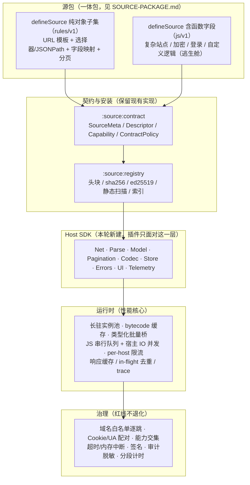

# 插件系统设计（目标态 v2）

> 状态：**本轮评审结论，取代旧版 `docs/plugin-engine.md`（已归档至 `docs/_archive/2026-11-12/`）**。
> 实施状态（2026-11-13）：S0/P0/P1/P2/P3 已全部完工（长驻运行时、版本路由、`rules/v1`、遥测与规则测试面板）；
> 本文 §0 的「当前瓶颈 / 尚未建立」等表述是 2026-11-12 评审时点基线，不是当前现状。
> 当前现状以代码为准，后续工作见 `docs/work-plan.md`。
> 设计输入来自源码事实与社区横向调研，不是对旧文档的续写。
> 权威基线：`docs/architecture.md`（ADR-002/003、§4.6/§4.7）、
> `docs/contract/source.d.ts` 与 `source-v4.d.ts`。重构已完工，实施顺序记录见 `../_archive/2026-11-13/REFACTOR-PLAN.md`（仅追溯）。
> 源包一体模板见 `SOURCE-PACKAGE.md`，Host SDK 冻结签名见 `HOST-SDK.md`（本文件 §5 为摘要，细节以该文件为准）。
> 日期：2026-11-12。

## 0. 这份文档为什么存在

初评阶段按约定只阅读源码与依赖产物（不读项目文档），独立完成评审；随后联网对比了
quickjs-kt 上游、Venera、Miru、Kazumi、Mihon/Tachiyomi、Legado、VS Code Extension Host、
Figma 插件系统、Extism；进入文档整理阶段后才回读 `docs/`，以代码为准校核现有文档。
结论是：**当前实现的性能瓶颈来自一个已经不成立的技术前提，而"内置通用能力"这一层尚未建立**，
且 `architecture.md` 的 ADR-003 / §4.6.3 原本已给出正确方向，是实现与后续文档发生了漂移。

关键证据（均可复核，不依赖任何项目文档）：

| 证据 | 内容 |
| --- | --- |
| `gradle/libs.versions.toml` | `quickjs = "1.0.18"`，且 1.0.18 是上游当前最新 release |
| 本机 Gradle 缓存 `quickjs-jvm.jar` 的 `javap` | `QuickJs.Companion.create(CoroutineDispatcher, ModuleLoader)` 公开；实例有 `compile()`、`evaluate(ByteArray)`、`addModule(ByteArray)`、`gc()`、`getMemoryUsage()`、`interruptEvaluation()`、`close()` |
| quickjs-kt 官方 README | `quickJs {}` DSL 明确标注为「不需要长驻实例时推荐」；支持 ES Module、ModuleLoader 字节码缓存 |
| `source/bridge/QuickJsEngine.kt:42-45` | 注释称「实例构造器私有、`quickJs{}` 结束即 close、被迫单发」——与上述 API 不符 |
| `docs/architecture.md:99 / 569` | ADR-003 与 §4.6.3 原本就写明 `QuickJs.create(dispatcher)`、`memoryUsage`、类型化 converter、`moduleLoader` 字节码缓存 |
| `docs/architecture.md:452-453` | §4.3 却写成「单发模型、阅后即焚」——同一文档内部自相矛盾 |

因此本次重构的性质是**回归架构原意并补齐能力**，不是推翻架构：ADR-002/003 与 §4.6.3 继续有效，
§4.3 的实现叙述、以及建立在该叙述上的后续文档被取代。

## 1. 目标与非目标

**目标**

1. **性能**：消除「每次调用重建 JS 运行时」；把引擎初始化从"每调用一次"降到"每源一次"，
   让网络与解析成为主要耗时，而不是引擎冷启动。
2. **能力内置**：把各源重复编写的 URL 处理、请求与状态码分类、解析、分页、字段归一化、
   编解码、缓存等收进宿主，插件作者只调用稳定 API。
3. **低门槛**：多数站点可用声明式规则描述；复杂站点保留完整 JS 逃生舱。
4. **工具链**：规则/源的可视化测试与 trace、分段计时、规则仓库，使"写好一个源"可自助完成。
5. **不退化**：三端一致、安全红线、签名供应链、v2/v3 源兼容、现有测试门禁全部保留。

**非目标**

- 不引入第二套 JS 运行时（ADR-003：三端同一份 QuickJS C）。
- 本轮不做 WASM 沙箱、不做独立进程隔离（ADR-002 已否决，列为远期评估）。
- 不在主仓预置任何站点 URL 或解析逻辑（C1）。
- 不复制 Venera / Miru / Kazumi 的任何实现代码，只提炼设计（GPL/AGPL 隔离）。

## 2. 四项设计裁决

| 编号 | 裁决 | 依据 |
| --- | --- | --- |
| D-1 | 运行时改为**每源长驻 `QuickJs.create()` 实例 + 预编译字节码**；`init()` 只跑一次 | 上游 API 与 ADR-003 均支持；现单发模型使 `load/describe/defaultSearchOptions` 各重建一次，翻 30 页漫画会重建 30 次（`resolvePage → comic.onImageLoad → invoke → runCall`） |
| D-2 | 修订 ADR-002 对「声明式规则」的否决：否决其作为**唯一**机制，允许作为 **fast path**，必须配 JS 逃生舱 | Kazumi 证明声明式能把写源压到 5 个选择器，但能力上限等于字段数；Mihon 的 `ParsedHttpSource` 因「过度限制」被弃用。Kurisa 是漫画+小说+图片配置+翻译+账号+收藏的多形态引擎，不可能压缩成 5 字段 |
| D-3 | 生产装配必须接上版本路由 | `createSourceCatalog()` 目前直接用 `QuickJsPluginEngineFactory`，`VersionedPluginEngineFactory` 与 `strictV4` 的 `KurisaNativePluginEngineFactory` 只在单测中出现，apiVersion=4 源实际走垫片 |
| D-4 | 桥从「String payload + JSON.parse」升级为**类型化、可批量**的桥 | `build.gradle.kts` 已引入 `quickjs-converter`，库提供 `JsObjectHandle` / `TypeConverter`；Figma 实测跨边界约 0.1 ms/次，按属性往返会成为瓶颈 |

## 3. 目标架构



分层约束：

- `L1` 保持纯 Kotlin、零引擎依赖；安装期**不执行脚本**的可信输入（头块/索引）优先于脚本自报。
- `L2` 是唯一对插件作者暴露的 API 面；新增能力只在此层加方法或规则字段，不改 `L0` 的调用形状。
- `L3` 不持有 Repository / Database（沿用架构 §3.1.4），全部外部输入由装配层以 `PluginRuntimeSpec` 传入。
- `L4` 强制点下沉到 host call，而不是只做调用路径的一级命名空间检查。

## 4. 运行时生命周期

**安装期**（不执行脚本）

```
头块解析 → 权限展示 → 用户确认 → sha256 / ed25519 → 静态扫描 → 落盘 + 写库
        → 追加：compile(SDK + 源脚本) → bytecode 缓存
```

缓存键必须包含 `scriptSha256 + engineVersion + moduleName`；QuickJS 字节码与引擎版本绑定，
只加载可信来源，失效策略由宿主负责（上游 README 明确此约束）。

**装配期**（每源一次）

```
acquire(spec) → 命中缓存则复用长驻 runtime
  → QuickJs.create(dispatcher, whitelistModuleLoader)
  → define(__host …) 绑定注入一次
  → evaluate(bytecode: SDK) → evaluate(bytecode: 源脚本) → new 实例 → init() 一次
  → describe() → SourceDescriptor（缓存）
  → 能力 = 探测 ∩ 版本上界 ∩ 安装期声明
  → 设置预热（setting: 命名空间，宿主强制前缀）
```

`PluginRuntimeSpec.signature()` 改用 DB 里的 `sha256/version` 等稳定标识。现状
`RegistryChapterProvider.bridgeFor()` 每次 `chapters/payload/resolvePage` 都重新 `loadScript()`
读盘并计算 `script.hashCode()`，命中缓存前这笔 IO 已经付出，需消除。

**调用期**

```
能力门（下沉到 host call）→ evaluate(业务片段，不重建实例)
  → 类型化桥 → 宿主能力（网络/解析/缓存…）→ 结构化结果 → trace
```

- 跨调用状态仍以宿主 KV 为主通道，但**不再强制"无状态"**：长驻实例允许 JS 内缓存，
  宿主只需保证重建时状态可恢复。旧文档「每次求值重跑 init 是定义语义」作废。
- 纯函数型调用（`comic.onImageLoad` / `translate` / 声明式规则解析）走无状态快路径，可缓存结果。

**销毁期**

`invalidate / evict / close` → 取消在途 Promise → 释放 Html 文档池 → `close()`。
长驻带来的新风险必须同时治理（见 §9）。

## 5. Host SDK 能力清单

> 冻结签名见 `HOST-SDK.md`。下表为摘要，细节（签名、`HostResponse.truncated`、显式 `CONTRACT` 语义）以该文件为准。
> 每一项都要求**显式失败**：能力未实现或参数非法时抛
> `CONTRACT`，禁止返回空串/空对象等静默桩（现状 v2/v3 的 GBK/RSA 空串桩、UI Noop 需整改）。

| 组 | API（示意） | 宿主负责 | 插件作者不再写 |
| --- | --- | --- | --- |
| `Net` | `get/getHtml/getJson/getBytes/sendRequest/fetch` | 全方法、URL 与 query 构造、`@keyword` 编码、相对转绝对、Referer/Cookie/UA 配对、逐跳白名单、重试/退避、TTL 缓存、响应头与 `finalUrl` 回传、Cloudflare verdict | 各源里的 `fixUrl` / `buildQuery` / `headers()` / `fetchOk()` / 429-503-404 分类 |
| `Parse` | `Html.list/text/attr`、`selectMany`、`JsonPath.pick`、`Regex.match`、`Table.parse` | 一次 parse 多选择器、自动 dispose、图片懒加载属性回退（`data-src`/`data-original`/`src`）、实体与空白清洗、节点级 diagnostics | 手工 `HtmlDocument` 生命周期、重复选择器字符串 |
| `Model` | `Work.of(...) / Chapter.of(...) / Page.of(...)` | ID 稳定化、URL 绝对化、去重、章节号解析、缺省标题、`kind` 归一化、危险头剥离 | 每个源的 `parseCard` / `parseManga` 映射样板 |
| `Pagination` | `page / cursor / offset / nextSelector` 声明 | 自动循环、去重、`maxPage` 推断、上限保护 | 手写 `while` 翻页、`search.page` 自委托 |
| `Codec` | md5/sha1/sha256/sha512/AES/RSA/GBK/Base64/HMAC/Hex/HTML 实体 | 三端一致实现、非法输入显式 CONTRACT | 源内加解密兼容代码 |
| `Store` | `kv.get/set/delete`、`cache.getOrPut(ttl)`、`settings.get` | 源隔离命名空间、TTL、设置回退链 | 手写 `loadData/saveData` 状态机 |
| `Errors` | `throwLoginExpired / throwRateLimited / throwNotFound / challenge` | 结构化错误码 + 宿主分类 + `LOGIN_EXPIRED` 重放一次 | `throw 'Login expired'` 字符串约定 |
| `UI` | `showMessage / launchUrl / webviewLogin` | 用户手势、独立 WebView 上下文、Cookie 回写 | 现状 Noop 需补平台实现 |
| `Telemetry` | `trace.begin/end`、`log` | 分段计时（init / JS / net / parse）、脱敏日志、命中率 | 源内 `console.log` 排查 |
| `Lifecycle` | `init / activate / deactivate` | 懒激活、按能力预加载、热重载（开发期） | — |

现状对照：`source/hostapi/HostApi.kt` 只有 7 个命名空间约 15 个方法；`KtorHostNetwork`
丢掉了 `finalUrl`、响应头、`CloudflareGuard.verdict`；`fetch` 的 `headers` 恒为空；
`Network.put/patch/delete` 在 polyfill 里存在但宿主返回 `UNSUPPORTED_METHOD`。
这些缺口正是 SDK 层要补齐的第一批内容。

## 6. 声明式规则层（fast path，一体包子集）

> 规范见 `SOURCE-PACKAGE.md`。本节保留定位与要点，正例模板以该文件 §3 为准。
> **定位**：`defineSource` 纯对象子集，覆盖结构同构的 HTML / JSON 站点；不是替代 JS 引擎。规则源不占 `apiVersion`，
> 用独立 `format: "rules/v1"` 标识，走同一个 `SourceDescriptor`、能力位、白名单与 `SourceHttpClient`。
> 任一字段写成函数即自动切 `js/v1` 引擎（逃生舱），宿主按“是否含函数”分派。

```json
{
  "format": "rules/v1",
  "key": "example.site",
  "name": "示例",
  "version": "1.0.0",
  "kind": ["manga"],
  "domains": ["example.site"],
  "baseUrl": "https://example.site/",
  "search": {
    "request": { "method": "GET", "url": "/search?q=@keyword&page=@page" },
    "mode": "html",
    "list": "//div[@class='item']",
    "fields": {
      "id": "//h3/a@href",
      "title": "//h3/a@text",
      "cover": "//img@src"
    },
    "pagination": { "type": "page", "maxPage": "//a[@class='last']@text" }
  },
  "detail": {
    "request": { "url": "/comic/@id" },
    "chapters": { "list": "//ul/li/a", "fields": { "id": "@href", "title": "@text" } }
  },
  "content": {
    "images": { "list": "//div[@id='images']/img", "value": "@data-src|@src" }
  }
}
```

要点：

- 支持 `html`（CSS/XPath 子集）与 `json`（受限 JSONPath，参考 Kazumi：`$`、`[*]`、下标、
  带引号字段名；不支持递归/过滤/切片/函数）两种 `mode`。
- 占位符由宿主替换并编码：`@keyword` / `@page` / `@id` / `@chapter` / `@source`。
- **逃生舱**：任意字段写成函数即切完整 JS 引擎（`format: js/v1`）；整源亦可显式声明切 JS；
  规则表达不了的能力（登录、签名参数、加密章节、图片解密）一律走 JS，不为它们扩字段。旧 `class extends ComicSource` 源零改动兼容，不再作为模板。
- **规则测试面板**（与格式同等重要）：参考 Kazumi `plugin_test_page.dart`，把
  `rawResponse` / `matchedFragments` / `diagnostics` / 最终模型按「请求 → 解析 → 内容」三步展示，
  支持复制原始响应、跳过节点诊断、取消在途测试。
- 分发沿用现有签名仓库：`Kurisa-Sources/index.json` 增加 `format` 条目（落盘扩展名随之分发，不另设 `rulesFile` 字段），
  sha256 / ed25519 / 静态扫描 / 二次确认流程不变。

## 7. 桥协议

| 现状 | 目标 |
| --- | --- |
| 全部 host call 为 `String` payload，Kotlin 侧 `Json.parseToJsonElement`，JS 侧 `JSON.parse`；`handleHtml` 甚至用 `buildString` 手拼 JSON | `JsObjectHandle` / `TypeConverter` 传结构化参数与结果（项目已依赖 `quickjs-converter`） |
| 单选择器、单请求，一次跨边界一件事 | 批量 API：`selectMany`、`requestAll`；响应体用句柄/流式传递，避免 300 KB 字符串反复拷贝 |
| `MAX_BODY_CHARS = 300_000` 静默截断 | 按媒体类型分级策略，截断必写脱敏日志，且向调用方返回 `truncated` 标记 |
| 能力门按 path 第一段，`invoke()` 只校验 `[A-Za-z_$][\w$.]*` 正则 | 能力门下沉到具体 host call；结构化错误码；`invoke` 白名单化 |
| `RejectModuleLoader` 拒绝一切 import | 白名单 ModuleLoader：只放行内置 SDK 模块（本地 bytecode），其余拒绝 |

SDK 因此可以从 Kotlin 字符串里那约 350 行 polyfill 中解放出来，改为**版本化、可编译、
可缓存的 JS 模块**；这也解决了 polyfill 里"不能用模板字符串"之类的脆弱约束。

## 8. 并发、缓存与性能验收

- **并发分层**：JS 求值必须串行（quickjs-kt 内部已有 `jsMutex`，单实例 confined），
  但宿主网络 IO 应在独立 dispatcher 上并发；每源 2~4 个实例池承载只读调用；
  写状态仍经宿主 KV 串行化。用 per-host 限流/熔断/重试替代整源 `limitedParallelism(1)`。
- **缓存分层**：bytecode（安装期）→ 描述符（装配期）→ 响应（TTL + ETag）→
  纯函数结果（`onImageLoad` / `translate`，按 URL+章节）→ in-flight 去重（同 URL 并发合并）。
- **验收方式**（不预设性能数字，全部用基准对比）：
  1. 计数器断言：单源连续 N 次调用，`QuickJs.create` 次数 = 1，`init()` 次数 = 1；
  2. 分段计时：`engineInit / JS / net / parse` 四段，翻页路径 `engineInit` 应恒为 0；
  3. 34 源兼容矩阵（`AllSourcesCompatibilityTest` 等）行为零变；
  4. 缓存命中率、每源内存（`getMemoryUsage()`）、超时中断与 `close()` 在三端一致。

## 9. 安全与权限（红线保留 + 长驻新增）

**保留**：`@domains` 白名单首跳与逐跳重定向复核、https→http 降级拒绝、UA/Cookie 由宿主
统一注入且与 `cf_clearance` 配对、危险头剥离、能力 = 探测 ∩ 版本上界 ∩ 安装期声明、
源私有 KV、`setting:` 前缀由 Kotlin 强制、ed25519 签名 + sha256 + 静态扫描 + 显式确认、
审计只记域名与状态码。

**长驻新增风险与对策**：

| 风险 | 对策 |
| --- | --- |
| 脚本修改全局对象造成跨调用污染 | SDK 命名空间 `Object.freeze`；实例健康探测与周期重置；异常时丢弃重建 |
| `KsoupHostHtml.docs` 只在 `dispose` 移除 → 长驻后累积 | 文档池上限 + TTL 自动回收 + 调用结束兜底 dispose |
| 定时器 / Promise 跨调用悬挂 | 调用级 deadline；`close()` 前取消在途任务；`setTimeout` 句柄归属本次调用 |
| 跨源状态串扰 | 每源独立实例 + 独立 `HostApi`（域名白名单按源绑定不可变），维持现有约束 |
| 模块加载放松后的供应链面 | ModuleLoader 只放行宿主内置 SDK 模块，外部 import 仍全拒 |
| native 崩溃 | 沿用 ADR-003 与 §4.6.3：Android 可选独立 `:source` 进程，三端崩溃上报 |

## 10. 错误模型与可观测性

- 结构化错误：`{ code, message, cause, retryable }`，`code` 对齐 `SourceErrorKind`；
  兼容期保留字符串子串分类作为 fallback，新 SDK 一律产出结构化错误。
- `LOGIN_EXPIRED` 仍由 `SourceRuntime.withPolicy` 重放一次，`onRelogin` 由宿主注入。
- 每次调用产出 trace：耗时分段、缓存命中、跳过节点诊断、响应体截断标记；
  审计日志维持脱敏（不记 Cookie 与正文）。

## 11. 版本与兼容

- `apiVersion` 2/3/4 语义不变；生产装配接上 `VersionedPluginEngineFactory` 后，
  4 才真正走 `strictV4` 原生策略。
- 声明式规则源用 `format: rules/v1` 独立标识，不挤占 `apiVersion`；
  规则 schema 变更走 `v2`，宿主按 `format` 分派执行器。
- 头块/索引是安装期可信输入，覆盖脚本自报值；`minAppVersion` 与能力上界校验不变。
- 垫片（v2/v3）日落条件：新形态源覆盖常用站点且稳定两个版本后，再评估删除路由；本轮不动。

## 12. 对现有 ADR 的关系

| ADR / 章节 | 处理 |
| --- | --- |
| ADR-002（否决 WASM、dex、**声明式规则**） | 建议修订措辞：否决"声明式规则作为唯一扩展机制"，允许作为 fast path + JS 逃生舱；WASM/dex 否决不变 |
| ADR-003（quickjs-kt 统一三端） | **继续有效且被强化**：长驻实例、字节码、类型化桥正是该 ADR 逐条列出的能力 |
| `architecture.md` §4.6.3 | **继续有效，作为运行时权威描述** |
| `architecture.md` §4.3 / §4.4 的单发叙述 | 被本文取代，已在原文加指向说明 |
| ADR-011（未评审草稿） | 归档；其中「常驻 vs 单发」的取舍结论基于错误前提，D1「调用一律无状态」作废 |
| `docs/plugin-engine.md` | 归档；其内容描述 v1 实现，保留作历史参考 |

## 13. 开放问题

1. 长驻实例在三端（尤其 Kotlin/Native iOS）的线程亲和与 `close()` 语义需 spike 实测。
2. 实例池规模与 per-host 限流阈值需要基准数据，不由文档拍板。
3. 一体包规则子集字段边界见 `SOURCE-PACKAGE.md §3`；超出即按 `js/v1` 处理，不扩字段（本项已结论，P2 按规范执行）。
4. `captchaScript` 类 JS 片段若引入，放在什么上下文执行、如何不破坏现有隔离模型（见 `SOURCE-PACKAGE.md §6`）。
5. 规则仓库 `index.json` 的 `format` 字段与旧客户端兼容性（fail-closed + 提示文案，见 `SOURCE-PACKAGE.md §1`）。
